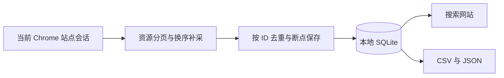

# TGEgg 群资料采集结果

完成时间：2026-11-02 02:29（北京时间）。

- 去重群组：153,190 条。
- 全部资源：313,871 条，其中频道 160,656 条，其他类型 25 条。
- 群组文件：data/groups.csv、data/groups.json。
- 全部资源文件：data/all_resources.csv、data/all_resources.json。
- 搜索网站：http://127.0.0.1:8766。

## 执行范围

已关闭“仅看未加入”、发言权限、公开状态和活跃状态等限制。先遍历全部资源的 3,136 页并补采近期 300 页，再单独遍历群组的 1,532 页及近期 100 页，最后换用成员数排序遍历群组 1,532 页及近期 100 页。源站维护、500/503 和会话过期均已恢复，最终采集状态没有遗留请求错误。

源站最后返回群组总数 153,193，本地去重保存 153,190，计数仍相差 3。源站不提供静态快照或稳定游标，无法确认这 3 条是分页漂移、新增记录或其他计数变化；不能把结果称为同一时刻完全无遗漏的快照。数据保留在本地，后续更新会按 ID 合并。

## 校验

SQLite 完整性检查通过。两类 CSV、JSON 的记录数均与数据库一致；JSON ID 无重复，群组导出不包含频道，抽样原始字段与数据库一致。详细结果见 data/verification.json。

本地网站的关键词搜索、类型/私有状态筛选、分页越界、无结果页面和 CSV 下载已验证，桌面及手机视图已检查。采集器的断点续采、ID 去重、暂停、额外字段保存和会话异常后导出已通过独立临时库检查。

自动更新默认每 6 小时运行。保持本地服务、Chrome 和站点登录开启；浏览器要求调试连接确认时需允许连接。此条件下的后续更新尚未实际运行到下一周期。

